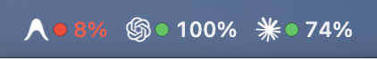
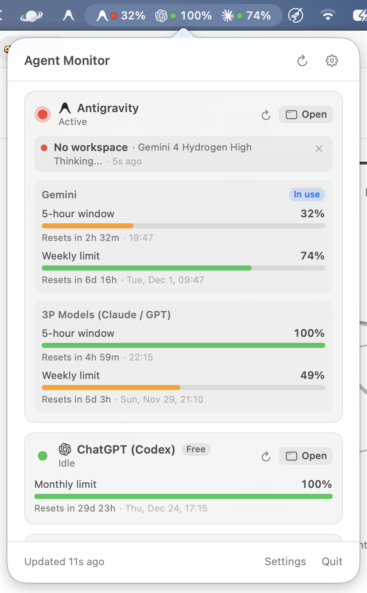
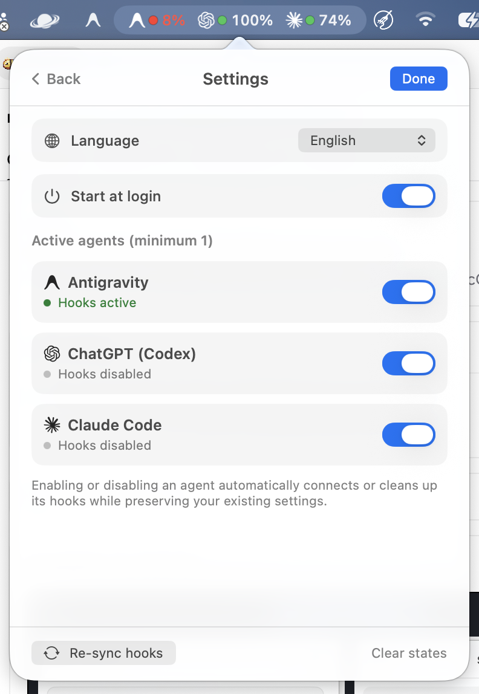

# Agent Monitor

[](https://github.com/JoacoCasta/agent-monitor/releases/latest)
[](https://github.com/JoacoCasta/agent-monitor/actions/workflows/ci.yml)
[-blue)](https://github.com/JoacoCasta/agent-monitor/releases/latest)
[](Sources/)
[](LICENSE)

[English](README.md) · [Changelog](CHANGELOG.md) · [Contribuir](CONTRIBUTING.md)

App nativa y liviana para la **barra de menú de macOS** (binario Universal para **Apple Silicon e Intel**, macOS 14+) que muestra en tiempo real el estado y las cuotas restantes de **Google Antigravity**, **ChatGPT (Codex)**, **Claude Code** y **GitHub Copilot**.

## Capturas de pantalla



| Panel principal | Ajustes |
| :---: | :---: |
|  |  |

## Descarga directa (Sin Terminal)

Descarga la última compilación Universal para macOS (`arm64` + `x86_64`) desde [GitHub Releases](https://github.com/JoacoCasta/agent-monitor/releases/latest):

- **Instalador DMG (`AgentMonitor-macOS.dmg`)**: Abre el `.dmg`, arrastra **Agent Monitor** a **Aplicaciones** y ábrelo.
- **Archivo ZIP (`AgentMonitor-macOS.zip`)**: Descomprime y mueve `AgentMonitor.app` a **Aplicaciones**.
- *Primer arranque en macOS*: Como esta app open-source aún no está notarizada por Apple, si macOS muestra aviso de desarrollador no verificado, haz **Clic derecho (o Control + clic) sobre `AgentMonitor.app` → Abrir** una sola vez.

`AgentMonitor.app` es **autocontenida**: al abrirse por primera vez instala sus scripts auxiliares, muestra el selector inicial de agentes, permite activar **Iniciar al encender** en **Ajustes** y configura los hooks sin necesidad de usar la terminal.

## Características

- **Indicador nativo Retina en la barra de menú**: Renderiza el logo vectorial monocromático oficial de cada agente activo a resolución 2x Retina junto a su semáforo en vivo y su porcentaje mínimo restante, adaptándose automáticamente a barras de menú oscuras o claras con un consumo de CPU en reposo cercano a `0.0%`.
- **Semáforo en tiempo real**:
  - **Amarillo**: El agente está esperando una respuesta explícita tuya (pregunta, permiso o aprobación de plan).
  - **Rojo**: El agente está pensando, ejecutando herramientas o con tareas en segundo plano.
  - **Verde**: El agente está inactivo.
- **Cuotas y resets en vivo**: Ventanas de 5 horas y límites semanales/mensuales, barras de progreso por color, alerta por cuota baja (`< 20%`) y cuenta regresiva en tiempo real hasta el próximo reset.
- **Selector de agentes y gestión segura de hooks**: Elige qué agentes monitorear al iniciar o desde **Ajustes**. Al activar o desactivar un proveedor, se conectan o limpian únicamente los hooks del monitor sin pisar tu configuración previa (incluyendo `notify` en Codex o un `statusLine` previo en Claude Code).
- **Notificaciones nativas de macOS**: Avisos mediante `UserNotifications` cuando un agente pasa a amarillo o cuando una cuota baja del `20%`. Al hacer clic en la notificación, abre o enfoca la app correspondiente.
- **7 idiomas integrados**: Detección automática del idioma de macOS + selector manual en **Ajustes** para **English**, **Español**, **Português**, **Français**, **Deutsch**, **简体中文** y **日本語**.

## Proveedores compatibles

| Proveedor | Logo oficial | Origen de cuotas | Origen de estado en vivo |
| :--- | :--- | :--- | :--- |
| **Google Antigravity** | Logo de Antigravity | `agy` CLI `statusLine` (`gemini` y `3p` 5h/semanal) | `~/.gemini/config/hooks.json` |
| **ChatGPT (Codex)** | Logo de OpenAI | `codex app-server` JSON-RPC (`account/rateLimits/read`) | `~/.codex/hooks.json` |
| **Claude Code** | Logo de Claude | `statusLine` en `~/.claude/settings.json` (`rate_limits`) | Hooks en `~/.claude/settings.json` |
| **GitHub Copilot** | Logo de Copilot | `copilot --headless --stdio` JSON-RPC (`account.getQuota`) | `~/.copilot/hooks/agent-monitor.json` |

## Compilar / Instalar desde el código fuente (Opcional)

Requiere **macOS 14.0+** y **Xcode Command Line Tools** (`xcode-select --install`; no hace falta instalar Xcode completo):

```bash
git clone https://github.com/JoacoCasta/agent-monitor.git
cd agent-monitor
./install.sh
```

`./install.sh` compila `/Applications/AgentMonitor.app`, instala los scripts auxiliares en `~/.gemini/agent-monitor/`, sincroniza los hooks habilitados y configura/inicia el LaunchAgent (`com.agentmonitor.app`).

**Desinstalar:** `./uninstall.sh`

## Preguntas frecuentes y solución de problemas

- **macOS indica que no se puede abrir `"AgentMonitor.app"` porque proviene de un desarrollador no identificado**:
  Abre **Finder → Aplicaciones**, haz **Clic derecho (o Control + clic) sobre `AgentMonitor.app` → Abrir** y confirma **Abrir**. Solo es necesario la primera vez.
- **Codex CLI pide revisar o aprobar hooks nuevos en `~/.codex/hooks.json`**:
  Ejecuta `/hooks` una sola vez dentro de Codex CLI para aprobar los hooks de Agent Monitor. Tu configuración previa de `notify` se conserva intacta.
- **Claude Code ya tenía un `statusLine` personalizado**:
  Agent Monitor encadena automáticamente tu comando `statusLine` previo para que ambos sigan funcionando y lo restaura al desactivar Claude Code o desinstalar. Las cuotas (`five_hour` y `seven_day`) se actualizan durante sesiones activas de Claude Code.
- **El icono en la barra de menú queda oculto detrás del notch de la MacBook**:
  Mantén presionada la tecla `⌘` (Command) y arrastra el indicador de Agent Monitor más hacia la derecha, u oculta otros iconos de la barra de menú.

## Privacidad

Agent Monitor no accede a credenciales privadas ni bases internas no documentadas: utiliza únicamente interfaces oficiales (`agy --settings`, `codex app-server`, `copilot --headless --stdio` y los contratos oficiales de `hooks` / `statusLine`) guardando el estado localmente en `~/.gemini/agent-monitor/`.

## Licencia

MIT — ver [LICENSE](LICENSE).
