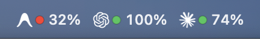
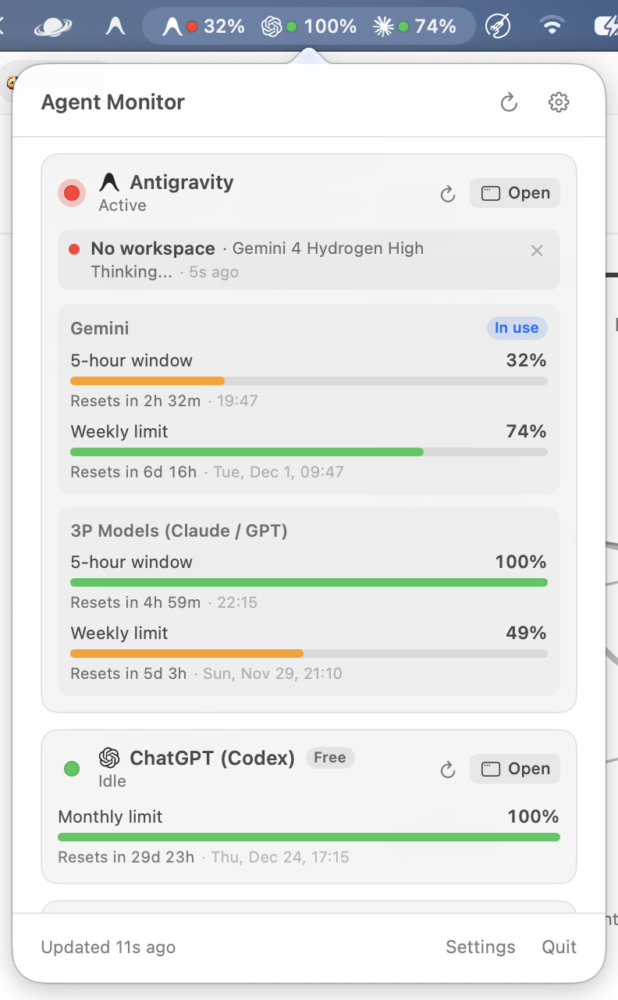
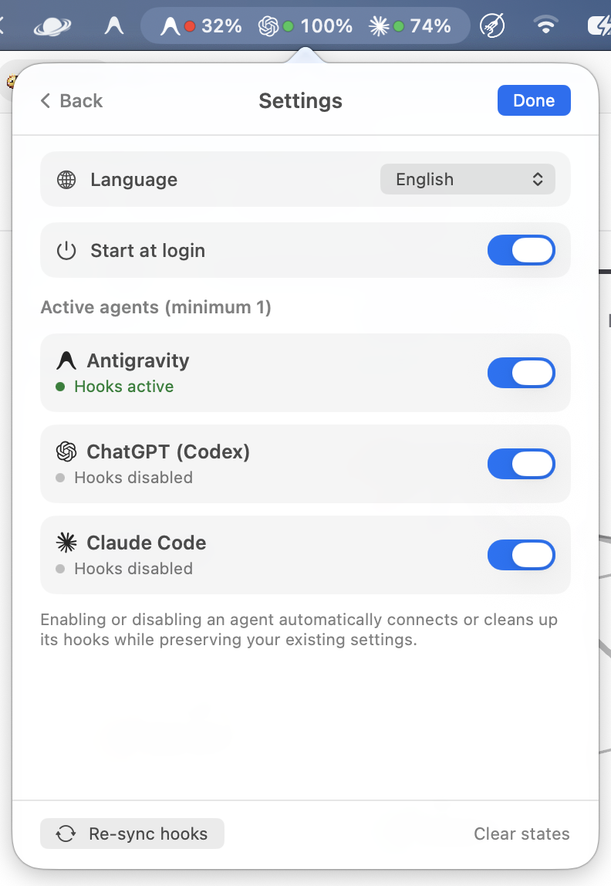

# Agent Monitor

[](https://github.com/JoacoCasta/agent-monitor/releases/latest)
[](https://github.com/JoacoCasta/agent-monitor/actions/workflows/ci.yml)
[](https://github.com/JoacoCasta/agent-monitor/releases/latest)
[](LICENSE)

[Español](README.es.md) · [Changelog](CHANGELOG.md) · [Contributing](CONTRIBUTING.md)

A lightweight, native system-tray / menu-bar monitor for **macOS**, **Windows**, and **Linux** to track live agent status and remaining quotas across **Google Antigravity**, **ChatGPT (Codex)**, and **Claude Code**.

## Screenshots



| Dashboard | Settings |
| :---: | :---: |
|  |  |

## Download (No Terminal Required)

Download the latest ready-to-run installer for your OS from [GitHub Releases](https://github.com/JoacoCasta/agent-monitor/releases/latest):

- **macOS (`AgentMonitor-macOS.dmg`)**: Open the `.dmg`, drag **Agent Monitor** to **Applications**, and launch it.
  - *First launch on macOS*: Because this open-source app is not Apple-notarized yet, if macOS shows an "unidentified developer" notice, **Right-click (or Control-click) `AgentMonitor.app` → Open** once.
- **Windows (`AgentMonitor-Windows-Setup.exe`)**: Double-click to install (no admin rights required) and launch directly into your system tray. A portable `AgentMonitor-Windows-Portable.zip` is also available.
- **Linux (`AgentMonitor-Linux-x64.deb` / `AgentMonitor-Linux-x64.tar.gz`)**: Install the `.deb` via Software Center / `sudo apt install ./AgentMonitor-Linux-x64.deb`, or extract the `.tar.gz` and run `./agent-monitor`.

All apps are **self-contained**: on first launch they automatically stage helper scripts, show an agent chooser, let you toggle **Start at login** inside **Settings**, and configure hooks safely with zero terminal setup.

## Features

- **Official agent logos & compact tray / menu-bar indicator**:
  - **macOS (SwiftUI + AppKit)**: Renders each enabled agent's official monochrome vector logo alongside a live traffic-light dot and its lowest remaining quota percentage, adapting cleanly to dark and light menu bars.
  - **Windows & Linux (Python + PySide6 / Qt6)**: Dynamic multi-dot tray icon reflecting each selected agent's live status, low-quota alert badge (`< 20%`), hover summary tooltip, and interactive popup panel with official vector provider logos.
- **Live traffic-light state**:
  - **Yellow**: Agent is blocked waiting for explicit user input (questions, permissions, elicitation, or plan approval).
  - **Red**: Agent is actively thinking, running tools, or executing background tasks.
  - **Green**: Agent is idle.
- **Multi-window quota tracking**: Shows 5-hour rolling windows, weekly/monthly limits, color-coded progress bars, low-quota warnings (`< 20%`), and live reset countdowns.
- **Provider selection & safe hook management**: Pick which agents to monitor on first launch or anytime in **Settings**. Enabling or disabling a provider safely merges or removes only its monitor hooks while preserving existing configs (including Codex `notify` and any pre-existing Claude Code `statusLine`).
- **Native desktop notifications**: Alerts when an agent waits for your input or when any quota drops below `20%`. Clicking a notification focuses that agent's app.
- **7 built-in languages**: Automatic OS language detection plus manual switcher for **English**, **Español**, **Português**, **Français**, **Deutsch**, **简体中文**, and **日本語**.
- **Scriptable `--status-json` output**: Exposes each enabled provider's `tag` (`AG`, `CX`, `CC`), live status, percentage, active session count, and quota windows for Waybar, Polybar, or custom scripts.

## Supported Providers

| Provider | Logo & `--status-json` Tag | Quota Source | Live Status Source |
| :--- | :--- | :--- | :--- |
| **Google Antigravity** | Official Antigravity mark (`AG`) | `agy` CLI `statusLine` (`gemini` & `3p` 5h/weekly) | `~/.gemini/config/hooks.json` |
| **ChatGPT (Codex)** | Official OpenAI mark (`CX`) | `codex app-server` JSON-RPC (`account/rateLimits/read`) | `~/.codex/hooks.json` |
| **Claude Code** | Official Claude mark (`CC`) | `~/.claude/settings.json` `statusLine` (`rate_limits`) | `~/.claude/settings.json` hooks |

## Build / Install from Source (Optional)

### macOS (14.0+, Xcode Command Line Tools)

```bash
git clone https://github.com/JoacoCasta/agent-monitor.git
cd agent-monitor
./install.sh
```

**Uninstall:** `./uninstall.sh`

### Windows (10/11, Python 3.9+)

```powershell
git clone https://github.com/JoacoCasta/agent-monitor.git
cd agent-monitor
powershell -ExecutionPolicy Bypass -File .\windows\install.ps1
```

**Uninstall:** `powershell -ExecutionPolicy Bypass -File .\windows\uninstall.ps1`

### Linux (X11 / Wayland, Python 3.9+)

```bash
git clone https://github.com/JoacoCasta/agent-monitor.git
cd agent-monitor
./linux/install.sh
```

- **Waybar / Polybar / scripts**: Run `agent-monitor --status-json` to get live JSON with each enabled provider's `tag` (`AG`, `CX`, `CC`), status, percentage, and quota windows.

**Uninstall:** `./linux/uninstall.sh`

## FAQ & Troubleshooting

- **macOS says `"AgentMonitor.app" cannot be opened because it is from an unidentified developer`**:
  Open **Finder → Applications**, **Right-click (or Control-click) `AgentMonitor.app` → Open**, and confirm **Open**. This is only required on first launch.
- **Codex CLI asks to approve or review hooks in `~/.codex/hooks.json`**:
  Run `/hooks` once inside Codex CLI to trust the newly added Agent Monitor hooks. Existing `notify` hooks are preserved.
- **Claude Code already uses a custom `statusLine`**:
  Agent Monitor automatically wraps and chains your previous `statusLine` command so both continue working, and restores your original command cleanly if you disable Claude Code or uninstall. Quota updates (`five_hour` and `seven_day`) appear during active Claude Code sessions.
- **Linux GNOME doesn't show the system tray icon**:
  Enable the **AppIndicator and KStatusNotifierItem Support** GNOME Shell extension so Qt/StatusNotifier tray icons appear in the top bar.

## Privacy & Official Interfaces Only

Agent Monitor reads no private credentials or undocumented internal databases. It relies strictly on documented CLI/hook interfaces (`agy --settings`, `codex app-server`, and official `hooks` / `statusLine` contracts) and stores state locally under `~/.gemini/agent-monitor/`.

## License

MIT — see [LICENSE](LICENSE).
